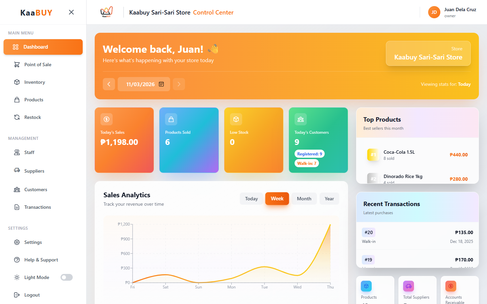
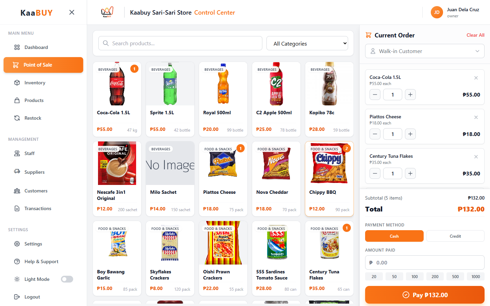
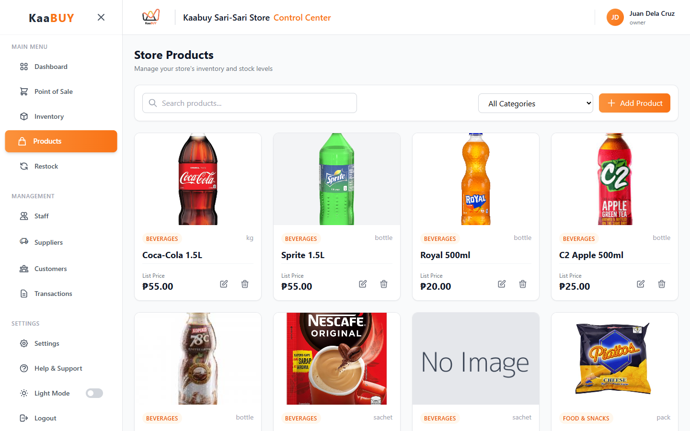
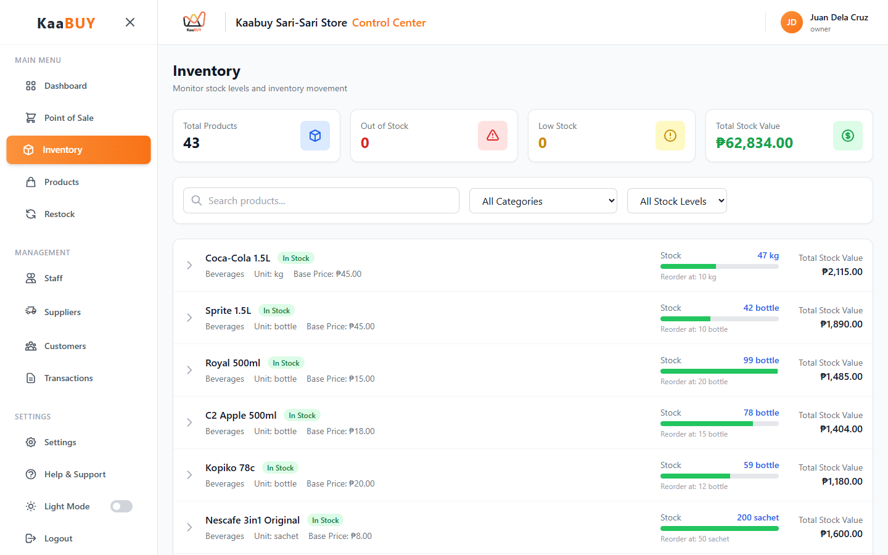
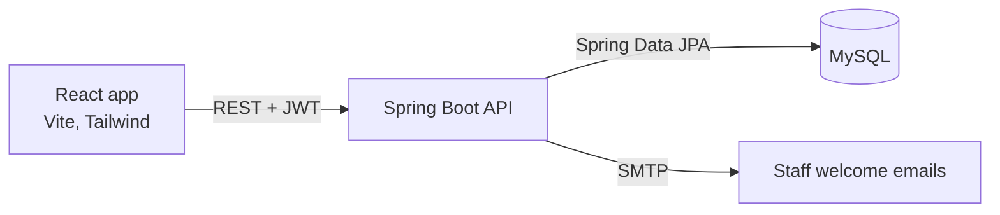

# KaaBUY

**Point-of-sale and inventory system for sari-sari stores**, the small neighborhood shops found on almost every street in the Philippines. Store owners ring up sales, track stock and supplier deliveries, keep tabs on customer credit (*utang*), and see how the store is doing, all from one dashboard.


Team project, November to December 2025. This repo has the whole app: the React frontend in [`frontend/`](frontend) and the Spring Boot API in [`backend/`](backend).



## Features

- **Point of sale:** product grid with photos and categories, a running order, walk-in or saved customers, cash or credit payment, and quick cash buttons.
- **Inventory:** stock levels against reorder points, low-stock and out-of-stock flags, and total stock value.
- **Restocking:** record deliveries from suppliers with quantities, supplier prices and dates.
- **Customers and credit:** customer list with outstanding *utang* balances and a way to record payments.
- **Transactions:** full history with search and filters by date and payment method.
- **Sales dashboard:** today's sales, products sold, low stock and customer counts, sales charts by day, week, month or year, top products and recent transactions.
- **Staff and roles:** owner and staff accounts. Only the owner can manage staff, suppliers and restocking; staff see the dashboard and products in view-only mode. New staff get their login by email and must change the password the first time they sign in.
- **Products:** add and edit products with photo upload, prices, units and reorder levels.
- Light and dark mode.

| Point of sale | Products | Inventory |
|:-:|:-:|:-:|
|  |  |  |

## How it's built



| Part | Folder | Built with |
|---|---|---|
| Frontend | [`frontend/`](frontend) | React 19, Vite 7, Tailwind CSS 3, React Router 7, Recharts |
| Backend | [`backend/`](backend) | Java 17, Spring Boot 4, Spring Security with JWT, Spring Data JPA (Hibernate), JavaMail |
| Database | | MySQL, with sample data in [`backend/backup.sql`](backend/backup.sql) |

## My part

I worked on both sides of the app.

- **Backend (Java, Spring Boot):** the REST APIs and service logic for customers, orders, suppliers, stock records, transactions and dashboard statistics; staff management; the first-login password change; welcome emails; and global error handling.
- **Frontend (React):** the point of sale, customers, restocking, transactions and inventory pages; the sales dashboard; staff management with role-based access; and a UI overhaul across the app, including the landing page.

## Run it locally

### Backend

You'll need Java 17 or newer and MySQL. By default the API connects to `kaabuy_db` on `localhost:3310` as `root`, and creates the database if it doesn't exist. Set these environment variables first:

| Variable | What it's for |
|---|---|
| `JWT_SECRET` | Required. Any random string of at least 32 characters |
| `DB_URL`, `DB_USERNAME`, `DB_PASSWORD` | Optional. Override the database connection |
| `MAIL_USERNAME`, `MAIL_PASSWORD` | Optional. A Gmail address and app password for staff welcome emails |

```bash
cd backend
./mvnw spring-boot:run
```

On Windows, run `mvnw.cmd spring-boot:run` instead. The API starts at http://localhost:8080. To load sample data, import [`backend/backup.sql`](backend/backup.sql) or follow the [mock data guide](backend/MOCK_DATA_IMPORT_GUIDE.md).

### Frontend

You'll need Node 20.19 or newer.

```bash
cd frontend
npm install
npm run dev
```

Then open http://localhost:5173. The app calls the API at `http://localhost:8080`; to use another address, create `frontend/.env` with `VITE_API_URL=<your backend URL>`.

The screenshots show the app running with the project's sample data.
